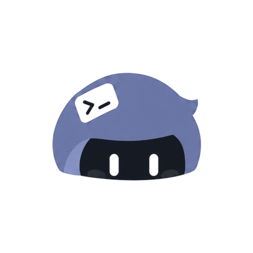

<p align="center">
  
</p>

<h1 align="center">term-fleet</h1>

<p align="center">One terminal fleet, controlled from anywhere.</p>

<p align="center">
  <a href="https://github.com/CarlOpenLab/term-fleet/actions/workflows/ci.yml"></a>
  <a href="https://github.com/CarlOpenLab/term-fleet/releases/latest"></a>
</p>

`tfd` owns the PTY sessions on a machine and serves them over a single
WebSocket. A desktop client built with Mygo — a native window, drawn by Mygo's
own UI toolkit and terminal rather than a WebView — and a browser or phone
client all attach to that same connection, so every terminal tab on the phone
is the same shell as the tab on the desktop.

Machines can also dial *out* to a relay (`tfrelay`) on a public server, so the
fleet is reachable from outside the LAN without a port forward, a public
address, or a VPN. The relay routes bytes and nothing else — see
[PLAN.md](PLAN.md) §3.

Design notes and the protocol draft live in [PLAN.md](PLAN.md).

## Download

Every [release](https://github.com/CarlOpenLab/term-fleet/releases) ships two
kinds of package, both built by
[`.github/workflows/release.yml`](.github/workflows/release.yml) from the pushed
tag:

| what | assets |
| --- | --- |
| the desktop app | macOS `.dmg` (universal), Windows `Setup .exe` plus a portable `.zip`, Linux `.deb` and `.tar.gz` |
| the command-line tools | `tfd` (the agent) and `tfrelay` (the relay) for macOS, Linux and Windows |

`checksums.txt` holds the SHA-256 of every asset. The desktop app carries its own
daemon, so a machine that runs the window needs no separate `tfd`; take a tool
archive for a headless member, and take `tfrelay` for the host that routes.

Release assets carry no Apple or Microsoft signature, so macOS quarantines the
downloaded `.dmg` and Windows SmartScreen warns about the installer: right-click
→ Open on macOS, or *More info → Run anyway* on Windows.

## Status

M0 through M5 are done: the walking skeleton, the PC client, the relay, the
client's tunnel mode, Windows hosts, and the deployment pieces.

- PTY sessions, byte-offset output history, one multiplexed WebSocket, and a
  single-controller model with viewers.
- The browser client: a session list grouped by machine, keyboard-driven
  new/close, selection with a copy button at it, reopen-from-cursor after a
  dropped link, and the five-state glyph on every row — working, waiting,
  idle, error, exited — with the message the program itself reported. A new
  shell opens in the directory the shell on screen stands in — the same follow
  the desktop's splits use — and a double-click on a row names the shell. There
  is no tab strip: the list is the switcher, on a phone as on a desktop.
- It is served by the daemon *and* by the relay, from one build: the server
  reports which transport it speaks (`/tf/config`), so a browser tab and a
  phone load the same code. The desktop window is native, and attaches to the
  same sessions rather than loading that code.
- `tfdesktop`: the same daemon behind a native Mygo window — mygo's `ui`
  controls and its terminal plugin draw the window, so there is no WebView and
  no xterm in the PC client. A shell there is a real shell on the machine, and
  the daemon underneath is what lets a browser drive the very shell on screen.
  The window is a wash of colour behind floating cards, and a column
  at the left that is the fleet itself — this machine first, then every machine
  the relay says is here, each a group of sessions with a state glyph, the time
  since its state began and a count. There is no tab strip and no status bar:
  the column's foot carries the palette, the settings and the counts of what
  needs you, is working and has finished, and the window's title carries the
  count of what needs you.
  The body is cards: a 44px header with the shell's name, its directory, the
  message the program reported and — on the hover — the split and close
  controls, and the terminal under it, the card's corners clipping both. `⌘D`
  puts a second shell beside the one on screen and `⌘⇧D` above or below it,
  with an 8px gap the pointer drags between the panes, and a pane the user is
  not in fades with its text. `⌘P` opens the command palette — sessions,
  machines and commands, with its own fuzzy order — and `⌘J` goes to the
  next session that needs you.
  A new shell — from a split, from `⌘T`, or from a group's ＋ — opens in the
  directory the shell beside it stands in, so a person who has cd'd somewhere
  gets the second pane there rather than at the home directory. The daemon asks
  the operating system where the process is now (`/proc` on Linux, `lsof` on
  macOS) and falls back to the directory the shell was started in.
  A shell is named by a double-click on its row — Enter commits, Escape lets go
  — and the name is the session's title, so every client watching the shell
  reads it. The interface language is chosen in 设置 → 终端: 跟随系统, 中文 or
  English; the appearance and the window's wash are chosen in 设置 → 外观.
  The settings window picks the terminal's font, size and language, stores this
  machine's relay credential, turns the local service on or off, and decides
  whether other clients may take this machine's shells. Reaching the other
  machines needs nothing typed: a window asks the relay for a short-lived
  *control token*, proving itself with the device credential it already joins
  the fleet with (`/relay/control-token`), and that credential — not the fleet's
  shared secret — is what its client link presents. The font field suggests the
  families installed on the machine and takes any name, so a Nerd Font build
  ("Maple Mono NF" beside "Maple Mono") is selectable. Edited text fields are
  saved by 应用, which the header offers only while there is something to
  apply; a shell is named after its program ("zsh 1") until it sets a title.
- **What each shell is doing**, on both clients: the daemon reads the program's
  own reports (`OSC 7501`), a notification sequence (`OSC 9`), the bell, a
  spinner in the terminal title and whether output is still arriving, and
  reports `idle`, `working`, `waiting`, `error` or `exited` with the message,
  its kind, a progress and an unread mark. A program can drive its own row:
  `printf '\033]7501;state=blocked:kind=permission:msg=%s\033\\' "$(printf 'Approve?' | base64)"`.
- **It tells you when one needs you.** A session that comes to need the user, a
  program that reports a failure, or an agent that finishes while the window is
  behind something else posts a notification; its click puts that session on
  screen. The Dock icon counts what needs you, and 设置 → 通知 decides which of
  the three is worth a banner.
- **Every shortcut is yours.** The window's keys are an action list — the
  keyboard, the command palette, the buttons on an empty card and the menu
  accelerators all read it — so 设置 → 键盘 can record a new chord, name a
  collision, clear one, or put the defaults back. Rebinding ⌘D to ⌘K moves the
  split, not just the label.
- `tfrelay` + `agent`: machines dial out to a public relay and are controllable
  from anywhere; a dropped link is a routing outage, not data loss — sessions
  and their output history live in the member and survive it.
- Windows hosts, through ConPTY: `internal/session` abstracts a pty behind one
  interface, because a Unix pty is a file descriptor and a ConPTY is a console
  object that owns the process it launched.
- A phone-shaped client: a drawer sidebar, and an accessory key bar for the
  keys a soft keyboard does not have.

`deploy/` holds a systemd unit for the relay, a Caddyfile that terminates TLS
in front of it, a user unit for members, and a runbook covering the security
model. The relay rate-limits failed credentials per address and takes the
client token in the first frame rather than in the URL.

## Layout

```
cmd/tfd/               the daemon
cmd/tfdesktop/         the desktop shell: same daemon, plus a native Mygo window
cmd/tfrelay/           the public-side router: enroll members, route streams
internal/protocol/     the wire format, shared with clients
internal/tunnel/       the relay envelope; the session protocol rides inside it
internal/session/      PTY, output ring buffer, session manager
internal/hub/          WebSocket fan-out and who-may-type policy (the lease lives here)
internal/relayclient/  the client half of the relay protocol, for a program that drives a fleet
internal/relay/        member registry, stream routing, presence
internal/agent/        dials out to a relay, projects streams onto the hub
internal/daemon/       hub + client wiring shared by both entry points
internal/web/          go:embed of the built client
web/                   the client itself (Vite + TypeScript + xterm)
deploy/                systemd units, Caddyfile, and the deployment runbook
scripts/acceptance.mjs headless end-to-end run against a real browser
scripts/relay-acceptance.mjs  the same, across a relay, against the real binaries
scripts/relay-browser.mjs     a real browser through a relay, as desktop and as phone
```

## Run

The client is embedded with `go:embed`, so build the web step first. A bare
`go build` still succeeds and serves a page telling you to do this.

```sh
pnpm --dir web install
pnpm run build            # web + tfd + tfdesktop into bin/
./bin/tfd                 # listens on 127.0.0.1:7678, serves the client at /
./bin/tfdesktop           # a native window on the same sessions, free loopback port
```

The desktop shell is also a Mygo CLI project. `mygo.json` names `cmd/tfdesktop`
as the app, so the window can be built and run through the toolchain Mygo ships
instead of plain `go build`: `go tool mygo dev` builds, launches, and rebuilds on
Go changes, and `go tool mygo build` writes an app bundle to `dist/`. The other
two binaries (`tfd`, `tfrelay`) are not Mygo apps and stay on `go build`.

```sh
pnpm run build:web        # the embedded client, once
go tool mygo dev          # build + launch tfdesktop, rebuild on change
go tool mygo build        # a distributable bundle in dist/
```

For UI work on the browser client, skip the recompile: build the assets and
point the server at them. The window's own UI is Go, so changing it needs
`pnpm run build:desktop`.

```sh
pnpm run build:web
./bin/tfd -addr 127.0.0.1:7678 -web-dir internal/web/dist
```

`tfd` refuses to listen on a non-loopback address unless you pass `-token`.
It runs arbitrary commands and serves a shell; that is not a service to expose
by accident.

| flag | meaning |
| --- | --- |
| `-addr` | listen address, loopback by default |
| `-token` | shared secret every client must present |
| `-allow-origin` | extra WebSocket Origin patterns, for a dev server on another port |
| `-idle-controller` | how long a silent controller keeps control (default 30m) |
| `-web-dir` | serve the client from disk instead of the embedded copy |
| `-relay` | dial this relay member endpoint; empty keeps the machine LAN-only |
| `-device-id` / `-device-secret` | this machine's relay credential |
| `-machine-name` | the name shown in the relay's machine list |
| `-relay-ca` | PEM file to trust as the relay's CA, for a relay behind a private certificate |
| `-allow-control` | whether other clients (a browser, a phone, another machine) may drive the shells here; default true, `false` leaves them read-only |

`tfrelay` also takes `-control-token-ttl` (default 15m), the lifetime of the
credential an enrolled machine gets from `/relay/control-token`. It is how a
desktop reaches the rest of the fleet without the shared client token, which
stays what a browser or a phone is given.

`tfdesktop` takes `-addr` and `-web-dir` as well, plus `-shell` (the shell new
tabs run) and `-cwd` (their working directory). Its relay credential, the
terminal's font and size, and whether the local service listens are not flags:
the Settings window writes them to `settings.json` under the OS config
directory (`TERM_FLEET_CONFIG_HOME` overrides it) and applies them as you change
them, so this desktop shell can join a relay without a command line. A new tab
runs PowerShell on Windows when it is installed (`pwsh`, else `powershell`),
falling back to `cmd.exe` only if neither is present.

Enrolled with a relay *and* holding its client token, the window drives the rest
of the fleet: the 机器 panel lists every machine on the relay, and a shell on
another machine opens in a tab here under that machine's own arbitration — one
writer at a time, on a lease with an epoch. A shell someone else holds is marked
只读 in the corner of its pane and offers 拿回控制权 from the header; a shell of
this machine's that another client is typing into lights up along its edge, so
the fact reads from across the room. The machine
the shell runs on takes it back with one click, because it is that machine's
shell. The token is the fleet's
client secret, not this machine's device credential: keep it like a password,
because today it is the whole authority over every machine on the relay.
`docs/takeover.md` has the design and what is still missing.

A relay that terminates TLS with a private certificate needs a member to pin
that certificate, so the Remote pane has a *CA certificate* row. The value is a
file path; the **Get from server** button fills it for you by fetching the
certificate the relay presents and writing it next to `settings.json`, and
**Browse…** opens a file picker if you already have the `relay.crt` from the
admin page's download link. Without it a connection fails with
`x509: certificate is not standards compliant` — browsers offer to click
through such a certificate, Go does not, and the desktop is Go.

The same pane shows what the link is actually doing — *connecting…*, *connected
as …*, or *cannot reach it: …* — because a missing CA and a wrong device secret
otherwise look identical: nothing happens, and the pane used to say only that
the form had been saved.

Endpoints: `GET /` (client), `GET /healthz`, `GET /ws` (WebSocket).

## Reach it from anywhere

A relay is a router, not a hub. It never parses a session frame, never holds a
PTY, and never decides who controls a session; it pairs a client stream with a
member stream and forwards bytes. Members dial out, so nothing listens on the
machine itself.

```sh
./bin/tfrelay -addr 127.0.0.1:7698 -devices devices.json \
              -client-token "$TOKEN" -public-url wss://relay.example/relay/agent \
              -tls-cert cert.pem -tls-key key.pem

./bin/tfd -addr 127.0.0.1:7678 \
          -relay wss://relay.example/relay/agent \
          -device-id mac-mini-1a2b3c -device-secret "$SECRET"
```

### The admin panel

The relay serves its own management page at `/admin` (`-admin-path`). Open it
once and it asks you to create an admin account; after that it is where you add
a machine, read the credential back, rotate the client token, and download the
CA certificate for a member to pin. `tfrelay enroll` and `tfrelay list` still
exist for scripted setup, but day-to-day there is no reason to reach for a
shell — and `enroll` from the panel takes effect on the next dial, no restart.

A fresh relay therefore starts with an *empty* registry: the first machine is
created from the page. It still refuses to start without a client token, still
refuses to listen off loopback without TLS unless you say `-insecure`, and the
admin account is protected by a rate-limited login and a PBKDF2 hash, because it
is the one credential that can mint all the others.

Each machine gets its own credential rather than one shared fleet secret, so a
laptop can be revoked without re-enrolling everything.

The relay also serves the client bundle, so one URL is the whole thing: open
`https://relay.example/` and it asks for the token, then lists every enrolled
machine with its sessions. The token is sent in the first frame, never as a
query parameter — a URL ends up in access logs, in intermediate proxies and in
browser history, none of which should hold the key to every machine. Failed
attempts are rate-limited per address, and the address is taken from the last
`X-Forwarded-For` hop (the one a proxy appends) so a forged header cannot
invent a fresh identity per try.

`deploy/README.md` is the full runbook: build, token, systemd, TLS, enrolling
machines, verification, upgrades, revocation, and an honest account of what the
relay can see (everything — it terminates TLS and carries your keystrokes).

## Tests

`ci.yml` runs the Go build, vet and test suite on Linux, macOS and Windows (with
the race detector on Linux) plus the web typecheck and build, on every push to
`main` and every pull request.

```sh
pnpm run test          # go test ./...
pnpm run check         # go vet + tsc --noEmit
pnpm run acceptance    # builds, then drives real Chrome against a real daemon
pnpm run acceptance:relay  # real tfrelay + tfd binaries, a session across the tunnel
pnpm run acceptance:relay-browser  # a real browser through the relay, desktop and phone
pnpm run acceptance:all            # all three
```

`scripts/acceptance.mjs` starts `bin/tfd`, opens two Chrome pages over CDP, and
asserts the things that only break in a browser: the prompt renders, typing
reaches the shell, `⌘T` opens a second tab, closing a tab detaches without
killing the session, a dropped socket reconnects without replaying the screen,
and a second client attaches read-only, cannot type, and can take control.

`scripts/relay-acceptance.mjs` runs the real `tfrelay` and `tfd` binaries,
enrolls a machine, and drives a shell through the tunnel. It exists for the
failures the in-process Go tests cannot see: flag wiring, the enroll →
configure handshake, and the base64 layering a client has to get right (a
tunnel payload is bytes, and so is a session frame's data).

`scripts/relay-browser.mjs` is the one that checks what the phone actually
runs: Chrome, through a real relay, with a real member behind it. It connects
with a token, creates a session, types into it, then opens a second page with
phone metrics and a `pointer: coarse` media override. That second page has to
see the *same session id*, attach read-only, refuse a touch key while it is a
viewer, take over, and then drive the host. A scripted WebSocket client cannot
prove any of that — only the real client can.

On Windows, `go test ./internal/session` is worth running natively: it starts a
ConPTY, runs a command through it, resizes it, and checks the exit code. None of
that can be verified by cross-compiling.

The Go side covers the routing itself, including the case that matters most:
`TestAgentRedialsAfterLinkLoss` drops every link the relay holds, waits for the
member to redial on its own, and asserts a session created before the outage is
still alive and attachable afterwards.

## Releasing

`release.yml` fires on a `vX.Y.Z` tag. It checks the tag against `package.json`
and `mygo.json` (all three must agree), lifts the matching `## X.Y.Z` section out
of [CHANGELOG.md](CHANGELOG.md) for the release notes, and publishes the release
up front. Each platform then attaches its own assets, so one failing platform
cannot take the rest of the download with it, and a final job hashes whatever
landed into `checksums.txt`.

```sh
# 1. agree on the version
$EDITOR package.json mygo.json CHANGELOG.md
git commit -am "chore(release): v0.2.0"
# 2. tag and push — the tag is what triggers the build
git tag v0.2.0 && git push origin main --tags
```

Nothing is code-signed, so there is no updater key to configure: the workflow
uses nothing but the `GITHUB_TOKEN` GitHub hands it. To exercise the whole flow
without cutting a tag, dispatch `release` from the Actions tab with an existing
tag as input.

## Two rules that shape everything

**Attaching is not creating.** A client that disconnects — phone slept, Wi-Fi
dropped, laptop lid closed — is detached, never closed. The shell keeps
running and the client reattaches by cursor, receiving only the bytes it
missed.

**One controller per session.** A PTY has one size and one stdin. If every
client could resize, the screen would thrash as the desktop and the phone
fought over cols/rows; if every client could type, a phone in a pocket would
interfere with real work. So a session has at most one controller that may
type, resize, and close, and any number of viewers that get a read-only
mirror. Input from a viewer is refused with `not_controller` rather than
dropped, so a client can offer to take control. Control is taken with `claim`
and given back with `release`, and a controller that sits silent for
`-idle-controller` loses it automatically.

**Closing a tab is not killing a session.** The tab's `×` detaches — the shell
keeps running and stays in the session list, which is what you want when you
were only peeking. Ending the process is a separate button, because that one is
irreversible for every other client looking at it.
